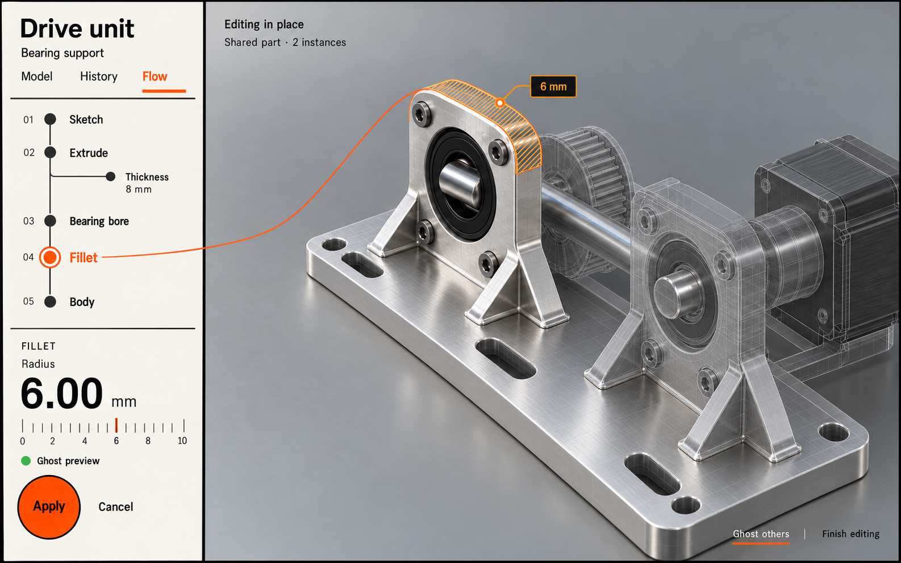

# Default presentation and interaction references

## Bundled default form

[instrument-rail.png](../assets/ui/instrument-rail.png) guides the bundled default layout/theme: continuous vertical sections, open graph stations, dedicated parameter instrument, circular Apply, and realistic model materials. Users can replace its entire layout and appearance through the separate presentation resources.

## Interaction evidence

| Reference | Approved behavior to preserve |
|---|---|
| [Flow baseline](../assets/ui/flow.png) | Shared graph and viewport, source-feature association |
| [Select first](../assets/ui/flow-select-first.png) | Click geometry to discover applicable actions |
| [Ghost preview](../assets/ui/flow-ghost-preview.png) | Inspect proposed surfaces before Apply |
| [Assembly overview](../assets/ui/flow-assembly-overview.png) | Component selection and relationship context |
| [Assembly isolation](../assets/ui/flow-assembly-isolate.png) | Edit in place, retain references, show shared-instance scope |
| [Linked assembly preview](../assets/ui/flow-assembly-linked-preview.png) | Coordinated effects of shared parameters |

These earlier images document interaction. Their boxed nodes, floating panels, and header chrome differ from the default rail; user layouts may adopt them or another composition. All layouts consume the same semantic information and commands.

All screenshots are generated visual concepts, not evaluated CAD geometry or evidence of feature support. Their dimensions and layouts are illustrative. Build production geometry, materials, typography, and interaction behavior deliberately rather than extracting a fake working model from the bitmap.
